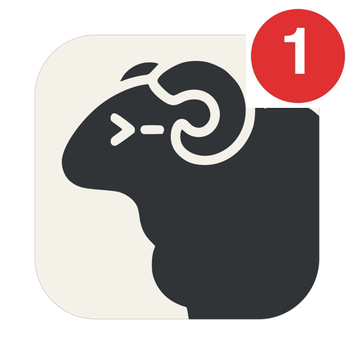

# Dock badge

A [Herdr](https://herdr.dev) app mod: puts the number of agents waiting for you on the macOS Dock icon. It draws nothing in the window and takes no space.



## Install

Copy the mod folder into your Herdr home:

```sh
cp -R mods/dock-badge ~/.config/herdr-app/mods/
```

Herdr starts a mod only when its block is in a layout. This mod's block is 0 px, so it runs without showing anything.

- On a personal layout, Herdr docks the 0 px block the first time it sees the folder.
- On the shipped `main` layout, Herdr does not dock mods. Add this block to a personal layout instead:

```json
{ "id": "dock-badge", "type": "block", "size": { "px": 0 }, "content": { "mod": "dock-badge" } }
```

Use one block, not several: each copy sets the same app-wide badge.

## What it counts

Agents with status `blocked` (waiting for an answer) and `done` (finished while you were away). A `done` agent becomes `idle` once you look at it, so the number drops on its own.

The Dock badge shows the total, up to `99+`. It is cleared when nothing is waiting.

## Notes

- The Dock badge is macOS only. On Linux and Windows the mod runs but `setBadge` is ignored.
- The badge is app-wide. Another mod calling `setBadge` will replace it; only the last call wins.
- A hidden block does not start its mod after a layout switch or app restart. The block must be visible with a size of 0 px, as above. See [herdrdev/herdr-app#1111](https://github.com/herdrdev/herdr-app/issues/1111).

## Recipe

[RECIPE.md](RECIPE.md) is the brief another agent can rebuild this mod from an empty folder.