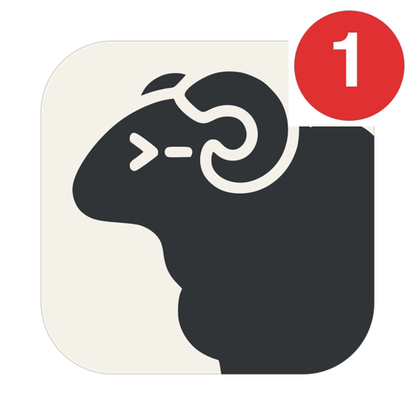

# Dock badge

A background mod for the Herdr desktop app: it puts the number of agents waiting for you on the macOS Dock icon, and draws nothing in the window.

## What you see

Nothing in the window. The mod has no visible UI and takes no space.

On macOS, the Dock icon carries a red badge with the count of agents that are blocked or done. Numbers above 99 show `99+`; nothing waiting clears the badge. Other platforms show no badge.

The preview image is an illustration of the Dock badge, not a screenshot: the mod draws no window content to capture.

## How it behaves

- `agents()` is live data. Any agent status change redraws the mod and, when the total changed, calls `setBadge`.
- The count includes `blocked` agents (waiting for an answer) and `done` agents (finished while the person was not looking). `done` becomes `idle` once viewed, so the count falls on its own.
- The Dock badge is app-wide: the last `setBadge` call wins. The mod calls it only when its own number changes, and passes `null` to clear.
- During `herdr-app check`, `checking()` is true, so `setBadge` is skipped and the check does not touch a running window's badge.
- The mod needs a block in the layout to run, but renders an empty `div()`. The block's size is 0 px, so it is invisible and takes no space. Herdr's own layout rule starts a visible 0 px block but not a hidden one.

## Built from

- `mods/dock-badge/main.js`: a `View` with only `render()`. Reads `agents()`, uses `checking()` and `setBadge()` from `herdr`, and returns an empty `div()`.
- `mods/dock-badge/mod.json`: `{"place":"bottom","size":0,"title":"Dock badge"}`. `place` and `size` are the docked block's initial placement and size.
- No timers, tasks, `exec`, `hc`, network, files, keys or commands.

## Watch out

- Herdr starts a mod copy only when its block is in the layout. A hidden block does not start after a layout switch or app restart, so the block must be visible with `"px": 0` rather than `"hidden": true` (herdrdev/herdr-app#1111).
- Herdr docks mods only into personal layouts. On the shipped `main` layout the block is not added automatically; clone the layout or add the block by hand.
- The block is a row or column child, so `size: { "px": 0 }` is its width in a row and its height in a column. Either way it takes no space.
- Installing the same mod in two blocks makes two copies, both calling `setBadge`; keep one.
- `setBadge` exists from Herdr 0.1.16. An older app fails to load the mod.
- The Dock badge is macOS only; other platforms ignore `setBadge` and show nothing at all.

## Done when

- `herdr-app check mods/dock-badge` prints `check passed`.
- After install, no new bar or panel appears in the window.
- With a blocked or done agent, the Dock icon shows the count; with none, the badge is gone.
- Answering or viewing all agents returns the badge to empty without any interaction with the mod.
- Switching layouts away and back keeps the badge working, because the 0 px block starts again.